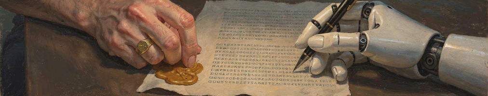
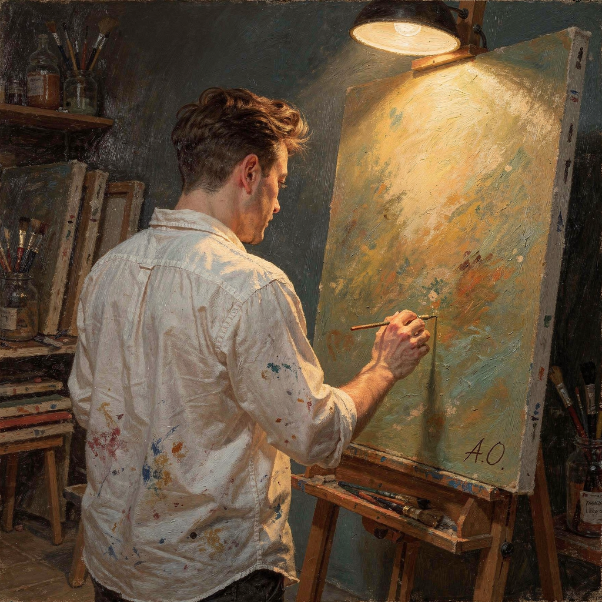
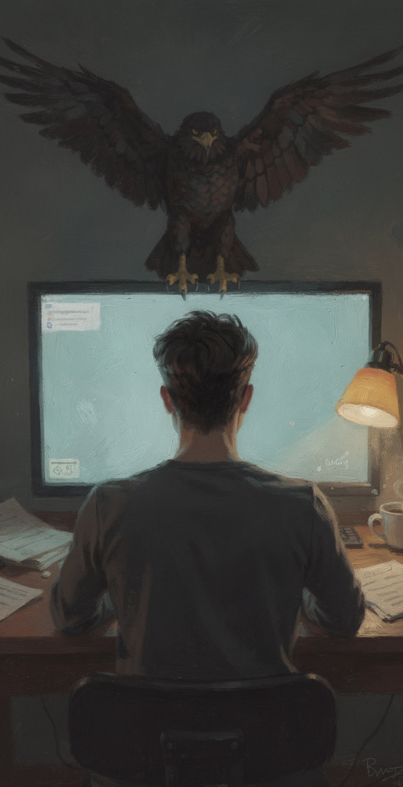
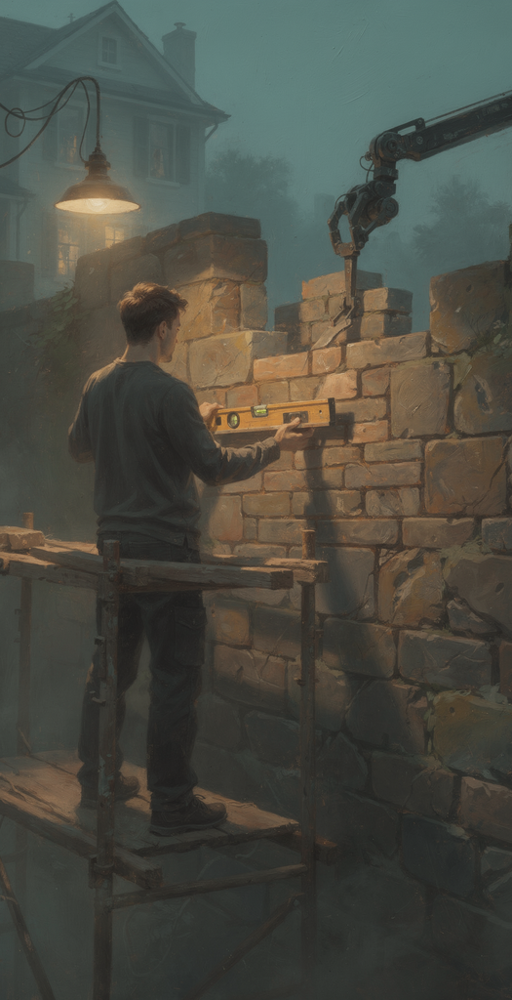

  
  

# The signature

The promise inside the name.

</img>

Last week I ran `git blame` on a file I was about to change. Every line had my name on it. Same color, same font. I had read maybe half of those lines when they were written. The other half an agent wrote on a Tuesday afternoon while I was in a meeting, and I approved them before dinner.
I kept staring at it anyway.

## My father's corner

</img>

My father was a painter. I wrote about him before[^1], about how much of what I know about work I learned watching him in front of a canvas. There is one thing I left out.

Nobody else ever touched one of his canvases. Not once.

And he signed last. After the final stroke, when there was nothing left he would change, the name went in the corner.

For a long time I thought the signature was about the hand. His name there meant: every centimeter of this was painted by me.

I think I had it backwards.

---

## Fifteen cartoonists

This month Nieman Lab documented more than fifteen New Yorker cartoonists whose signatures ChatGPT puts on cartoons they never drew[^2]. Someone asks for "a New Yorker-style cartoon" and gets one with "BLOPER" in the corner, Brendan Loper's pen name. His twin brother was the first to text him about it.

> "I'm not a territorial person, but my name is my name. It felt very much like a violation of my personhood."

Pat Byrnes has signed "P.Byrnes." with a period at the end since he was a teenager. Every fake the reporter found with his name on it ended with a period. The model learned the period.

To the model, the signature is more ink. It belongs to the style, like the sparse background and the one-line caption, and it learned it the same way it learned to draw a dog. To Byrnes it was the one part that was never style. "It was like signing a letter," he said. "Here's my statement, my gift to you to accept or reject."

That's what I had backwards about my father. The signature was a promise. It said: this one, I answer for. The hand was how he kept it.

## The eagle

</img>

It was a Friday, obviously.

The alert came at 17:40. Checkout was failing for anyone with a saved card, which is everyone who matters. Theo opened `git blame` on the payments module and every line said Theo. Including line 91, which had just taken checkout down, and which he had never read.

He remembered the PR, sort of. Tuesday. The agent had opened it while he was in planning. The description was clear and the tests were green. He approved it between two other things, in about forty seconds. Line 91 retried a card charge whenever the provider timed out. The provider had been timing out all afternoon, and charging anyway. Some people paid four times for one pair of shoes.

"Walk me through it," said the incident channel.

He started at the top. By line 91 he was reading code to twelve people the way you read a contract you already signed: out loud, discovering the clauses.

Nobody asked who wrote it. The commit trailer said `Co-Authored-By: Claude`, so everybody knew, and it changed nothing. Incident reviews find the human who clicked approve, because that is the only name that can be in the room. Theo wrote the postmortem himself. Action item one: the parts of a diff that can charge a card get read, every line, by a person. Action item two: the person's name goes on it after the reading. Only after.

Theo is made up. Rubens isn't. In 1618 he sold a Prometheus to an English ambassador with a note on the price list, "Original by my hand, the eagle done by Snyders"[^3], a hundred florins cheaper than the Daniel he had painted alone. He signed both. Nobody called him a forger, because the name came with the list, and with a man who would answer if the eagle was bad.

---

## Signed-off-by: me

</img>

So, back to the file with my name on every line.

Git already knows the eagle exists. `Signed-off-by` certifies that a contribution was made "in whole or in part" by you[^4], and the agents now add `Co-Authored-By: Claude` on their own.

What bothered me, looking at that file, was a different question.

> Which of those lines could I paint again in front of twelve people?

Addy Osmani wrote last month that reading every line was only ever one way to make sure a person understood what they were shipping and was in a position to say no[^5]. He thinks the line-by-line read is going away for most code, and that this is fine. The understanding, and the no, can't go with it.

There is an old law about this, older than any of the painters. Hammurabi, paragraph 229[^6]:

> If a builder builds a house and the house collapses and kills the owner, the builder is put to death.

There is no paragraph for the bricks.

You can't put a model on trial. The worst thing that can happen to it is being switched off. When the house falls, the investigation finds the name in the corner. That's what the name was for.

There is a tension here:
 
> Between the hand and the name.

> Between how fast I can approve and how much I could paint again.

> Between the father who signed nothing he didn't paint and the master who signed the eagle.

> Between the period the model learned at the end of "P.Byrnes." and the one thing it can't learn: being the one who answers.

---

## Sign last

My father signed when there was nothing left he would change. I used to think that was about perfection. Now I think it was about timing. You sign when you're ready to answer for that.

And you don't get ready in an afternoon. My father could put his name in that corner because of every canvas before it, the ones that taught him which colors crack and which corner fades in ten years. Rubens could sign the eagle because he could have painted the eagle. Nobody asked either of them what brush they used. The brush was cheap. The name certified the years behind the hand holding it.

It's the same with us. The agent is the brush. What makes a name worth anything on a PR is the years of reading code before you were allowed to skim it, and the incidents you were in the room for.

I still let the agent paint the eagle. I read the parts that decide whether the house stands. And I sign last, only what I could do again, slower, with people watching.

---

[^1]: [Musician programmer](https://github.com/alan-oliv/unstable-thought-diffusion/blob/main/musician-programmer/README.md), where my father first shows up on this blog.

[^2]: Andrew Deck, [ChatGPT is adding real cartoonists' signatures to fake New Yorker cartoons](https://www.niemanlab.org/2026/10/chatgpt-is-adding-real-cartoonists-signatures-to-fake-new-yorker-cartoons/), Nieman Lab, October 5, 2026. The Loper and Byrnes quotes are from there.

[^3]: Rubens to Sir Dudley Carleton, April 28, 1618. The eagle line is quoted in [Prometheus Bound (Rubens)](<https://en.wikipedia.org/wiki/Prometheus_Bound_(Rubens)>); the full priced list is in [this Rubens monograph](https://arthistory.columbia.edu/sites/default/files/content/faculty/pdfs/freedberg/Rubens-book.pdf) hosted by Columbia's art history department (12 MB PDF).

[^4]: [Developer Certificate of Origin](https://developercertificate.org/), the text your `Signed-off-by` line certifies. It was written for the Linux kernel in 2004.

[^5]: Addy Osmani, [The Code Nobody Reads](https://addyo.substack.com/p/the-code-nobody-reads), September 28, 2026. He borrows the "moral crumple zone" from [Madeleine Clare Elish](https://estsjournal.org/index.php/ests/article/view/260) for the engineer whose name is on the approval.

[^6]: [The Code of Hammurabi](https://avalon.law.yale.edu/ancient/hamframe.asp), paragraph 229, Yale's Avalon Project translation.
